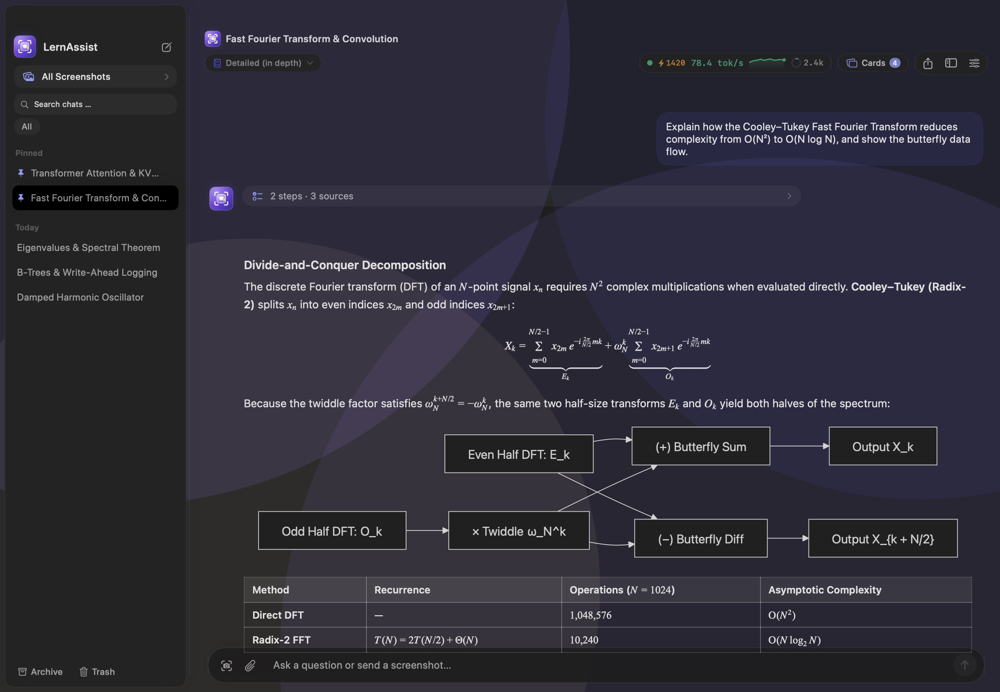
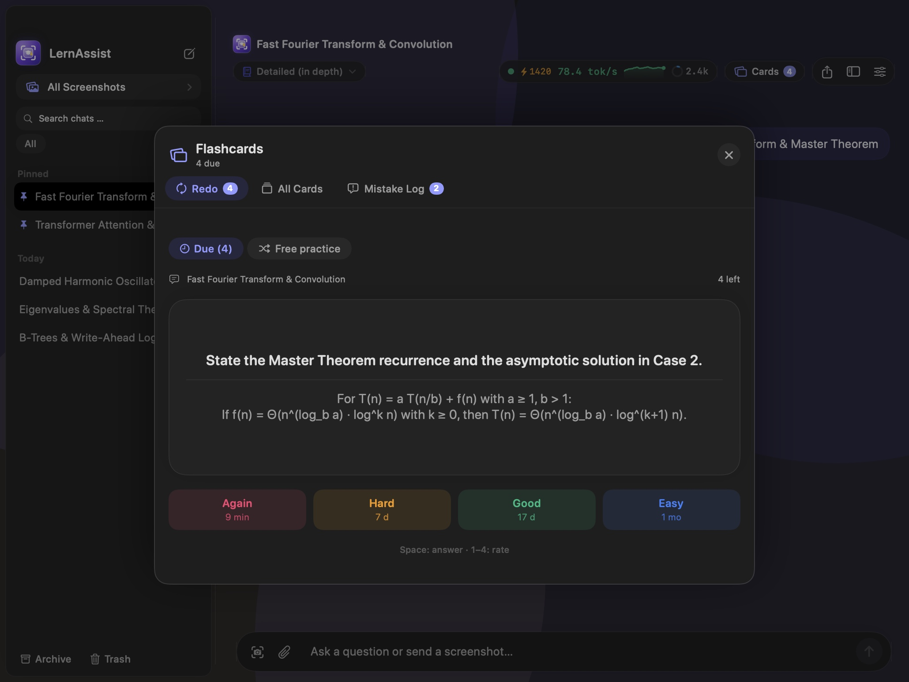
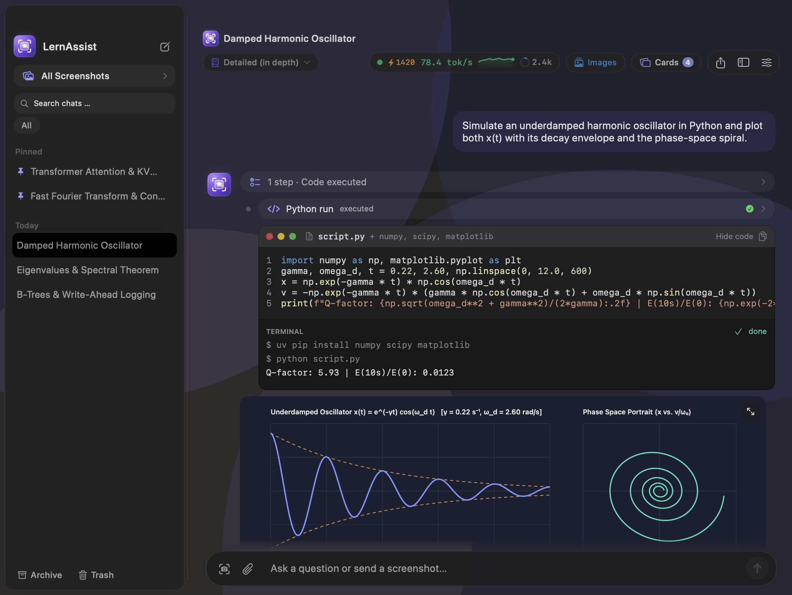
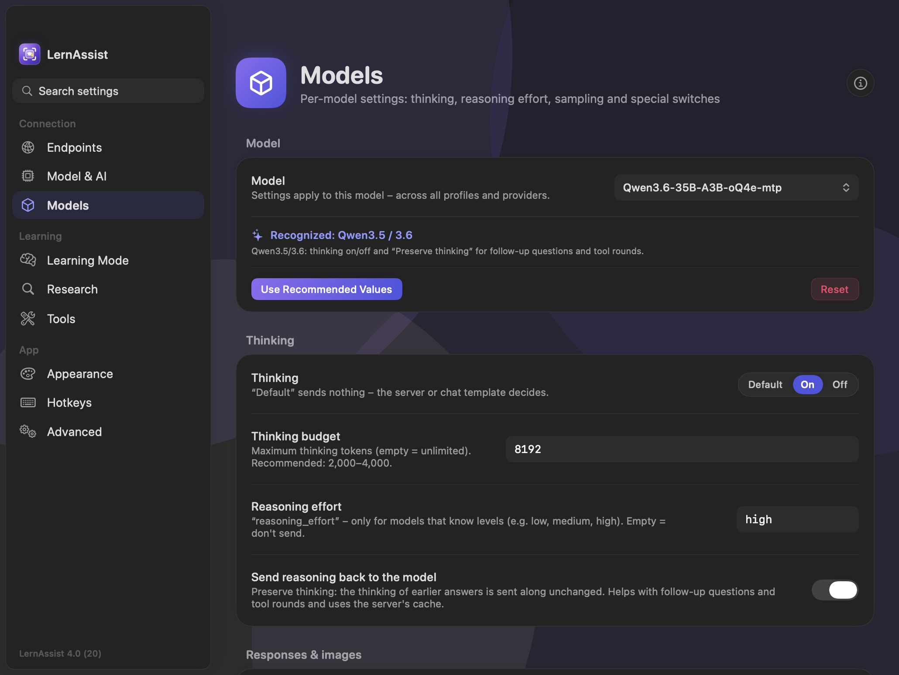
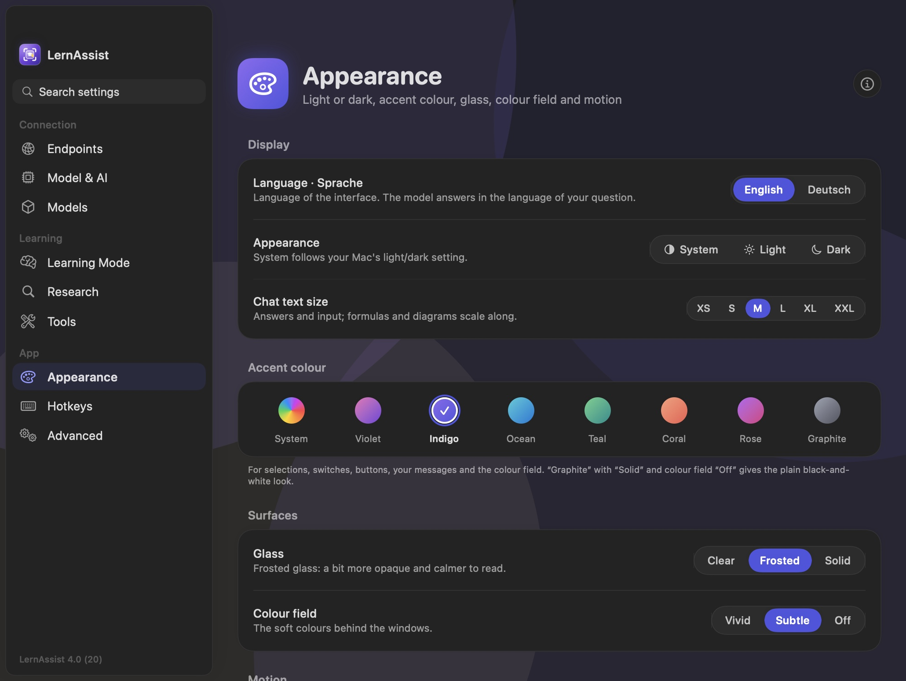

<p align="center">
  
</p>

<h1 align="center">LernAssist</h1>

<p align="center">
  <strong>Local AI study, research and coding assistant for macOS.</strong><br>
  Screen capture · FSRS-5 spaced repetition · Python sandbox · local web research · interactive visualizations
</p>

<p align="center">
  <a href="https://github.com/pyMoLt/LernAssist/releases/latest"></a>
  
  
  
  <a href="LICENSE"></a>
</p>

<p align="center">
  
</p>

Press a shortcut (`⌃⇧L`), select a slide, formula, diagram or code snippet on your screen, and explore it in an interactive study chat. LernAssist connects to local or self-hosted language model servers (**oMLX**, **LM Studio**, **Ollama** or **Apple MLX**) and pairs streaming explanations with FSRS-5 spaced repetition, an isolated Python coding sandbox, multi-source web research and live interactive visualizations.

## Features

**Interactive Study Chat & Didactic Modes**
- **Transparent streaming telemetry**: separates prompt processing (prefill speed, TTFT, KV-cache hit rate) from token generation (decode tok/s) with a live 5 Hz sparkline in the header.
- **Collapsible work steps**: reasoning tokens (`<think>`) and tool calls fold into a compact progress timeline while answers stream.
- **Didactic study modes**: *Detailed*, *Compact*, *Exam*, *Beginner*, *Tutor (Socratic)*, *Examples* and custom system prompts tailored to computer science, mathematics, physics, engineering and natural sciences.
- **Automatic titles & subject badges**: each session is tagged with a concise title and subject badge (*Algorithms*, *Linear Algebra*, *Physics*, *Systems* …) for one-click filtering in the sidebar.

**FSRS-5 Flashcards & Quiz Training**
- **FSRS-5 scheduler**: modern Free Spaced Repetition Scheduler with configurable target retention (80 %–97 %, default 90 %) and keyboard-driven review (`Space` to reveal, `1`–`4` to rate).
- **One-click card extraction**: condense any explanation or completed quiz question into 1–3 study flashcards with instant undo.
- **Interactive quiz cards & mistake log**: answer multiple-choice or free-text cards directly in chat; missed questions and forgotten cards are logged automatically so you can launch targeted error training with one click.

**Slash Commands & Study Sheet Export**
- `/quiz [count] [difficulty] [topic]`: generate interactive quiz rounds with a final score breakdown.
- `/case [topic]` (`/fall`): step-by-step interactive problem sets and case studies adapted to the active subject.
- `/summary [topic]`: structured study sheets with key takeaways, glossary tables, Mermaid diagrams and review questions.
- **A4 PDF & Markdown export**: export any answer or study sheet as a print-ready A4 PDF (including rendered KaTeX formulas and Mermaid diagrams) or Markdown file.

**Local Python Sandbox & Interactive Visualizations**
- **Isolated Python execution**: runs generated code locally via `uv` (`numpy`, `scipy`, `sympy`, `matplotlib`, `pandas`) and embeds high-resolution plots directly in the answer via collision-free `[B#]` references.
- **Interactive HTML artifacts**: renders live simulations and charts using locally bundled libraries (Chart.js, D3, Three.js, Plotly, ECharts, Cytoscape, Leaflet, P5.js) with full-screen and detached zoomable windows.
- **Automatic output repair**: fixes malformed LaTeX math, Mermaid diagrams, Markdown tables, tool JSON and common Python syntax errors before rendering, plus a one-click **Repair** button when a diagram or script still fails.

**Multi-Source Web Research**
- Queries **SearXNG** (with multi-server catalog and Bearer/Basic/header authentication), **Wikipedia**, **arXiv**, **PubMed** and **Stack Exchange** (plus optional Exa / Brave Search fallbacks), extracts full-page passages, reranks them via local oMLX `/v1/rerank` and cites sources inline (`[W1]`, `[W2]`).
- Built-in source health management with per-source time budgets (30 s default), automatic rate-limit cooldowns and per-phase timing breakdowns.

**Per-Model Controls & Flow Design**
- **Models tab**: configure thinking mode, reasoning effort, thinking budget, preserve-thinking, streaming, vision fallback, sampling parameters and custom `chat_template_kwargs` per model (with built-in presets for Qwen 3.5/3.6, Qwen 3.8 and Sage-A1.5).
- **Flow UI**: bilingual interface (English and German), light/dark/system themes, accent colors, adjustable glass strength, color fields, text scaling and instant search across all settings.

<p align="center">
  
  
</p>
<p align="center">
  
  
</p>

## Backends and Tools

LernAssist works on a single Mac or across a two-Mac setup (for example a laptop connected over LAN or Tailscale to a desktop Mac running large models).

| Component | Runtime / Protocol | Purpose |
|---|---|---|
| **oMLX** *(recommended)* | Apple Silicon MLX (`:8072`) | Chat, vision, thinking budgets, model management & `/v1/rerank` |
| **LM Studio** | OpenAI `/v1` or Native `/api/v0` (`:1234`) | Local GGUF / MLX models with server-side tok/s telemetry |
| **Ollama** | Native NDJSON `/api/chat` (`:11434`) | Local model serving with exact eval timings |
| **OpenAI-compatible** | `POST /v1/chat/completions` | `llama.cpp`, `mlx-lm`, vLLM or custom endpoints |
| **Python Sandbox** | Local `uv` virtual environment | Numerical computing, symbolic math and inline `matplotlib` plots |
| **Research Pipeline** | SearXNG · Wikipedia · arXiv · PubMed · Stack Exchange | Cited web & literature search with SSRF protection |

## Install

1. Download `LernAssist-<version>-macos-arm64.zip` from [Releases](https://github.com/pyMoLt/LernAssist/releases/latest), unzip it and move **Lernassist.app** to `/Applications`.
2. The app is **ad-hoc signed** and not notarized by Apple, so macOS Gatekeeper blocks the first launch. Either remove the quarantine attribute in Terminal:
   ```bash
   xattr -dr com.apple.quarantine /Applications/Lernassist.app
   ```
   or try to open the app once, then go to **System Settings → Privacy & Security** and click **Open Anyway**.
3. Follow the 5-step **Setup Assistant** on first launch to connect your local or remote model server and grant **Screen Recording** (for `⌃⇧L` region capture) and **Accessibility** (for global shortcuts).

Requirements: a Mac with Apple Silicon and macOS 26 or newer.

## Privacy

| What | Where it goes |
|---|---|
| Chats, screenshots, flashcards, mistake log and settings | Stored locally in `~/Library/Application Support/Lernassist/` |
| API keys and search server credentials | Stored in the macOS Keychain (`com.pymolt.LernAssist.apiKeys`) |
| Python sandbox scripts and generated plots | Executed locally in an isolated workspace with configurable network/download limits |
| Network | Only to your configured LLM endpoint and the search sources you explicitly enable |

LernAssist has no user accounts, no cloud sync, no analytics and no telemetry.

## Build from source

You need full Xcode 26 or newer on macOS 26+ (Apple Silicon).

```bash
# Run unit tests
xcodebuild test -project Lernassist.xcodeproj \
  -scheme Lernassist \
  -only-testing:LernassistTests \
  -destination 'platform=macOS,arch=arm64' \
  CODE_SIGN_IDENTITY="-" DEVELOPMENT_TEAM="" CODE_SIGN_STYLE=Manual

# Build ad-hoc signed Release app and package ../releases/LernAssist-4.0.0-macos-arm64.zip
scripts/build-dist.sh
```

| Folder | Contents |
|---|---|
| `Lernassist/` | SwiftUI/AppKit app source: views, view models, FSRS-5 scheduler, research pipeline, Python sandbox, bundled JS/HTML renderers |
| `LernassistTests/` | Unit, localization, auto-repair, research pipeline and UI snapshot tests |
| `LernassistUITests/` | UI automation tests |
| `tools/` | Localization (`translations-en.json` → `EnglishStrings.swift`) and settings search index generators |
| `design/` | Layered vector app icon sources (`.svg` and 1024 px preview) |
| `scripts/` | Release packaging (`build-dist.sh`) and icon asset generator (`make_icons.sh`) |

## Versions

| Version | Highlights |
|---|---|
| **4.0** | Flow design, bilingual UI (EN/DE), per-model settings & presets, interactive HTML simulations, automatic output repair, SearXNG server catalog, connection watcher, settings search |
| **3.0** | FSRS-5 spaced repetition, flashcards & mistake-training panel, `/quiz`, `/case` and `/summary` slash commands, A4 PDF/Markdown export, AI subject tags, Setup Assistant |
| **2.0** | Flow DS 2.0 surface hierarchy, live prefill/decode telemetry & sparkline, local Python `uv` sandbox, SearXNG research pipeline, collapsible work steps, archive browser |
| **1.0** | Initial release with global `⌃⇧L` screenshot capture, streaming chat (oMLX, LM Studio, Ollama), KaTeX + Mermaid rendering and study modes |

See the [changelog](CHANGELOG.md) for details.

## Credits and license

LernAssist is released under the [MIT License](LICENSE). It bundles open-source web rendering libraries ([markdown-it](https://github.com/markdown-it/markdown-it), [KaTeX](https://katex.org), [Mermaid](https://mermaid.js.org), [highlight.js](https://highlightjs.org), [Chart.js](https://www.chartjs.org), [D3.js](https://d3js.org), [Three.js](https://threejs.org), [Plotly](https://plotly.com/javascript/), [ECharts](https://echarts.apache.org), [Cytoscape.js](https://js.cytoscape.org) and [Leaflet](https://leafletjs.com)) under their respective MIT/BSD/Apache-2.0 licenses for offline rendering.
